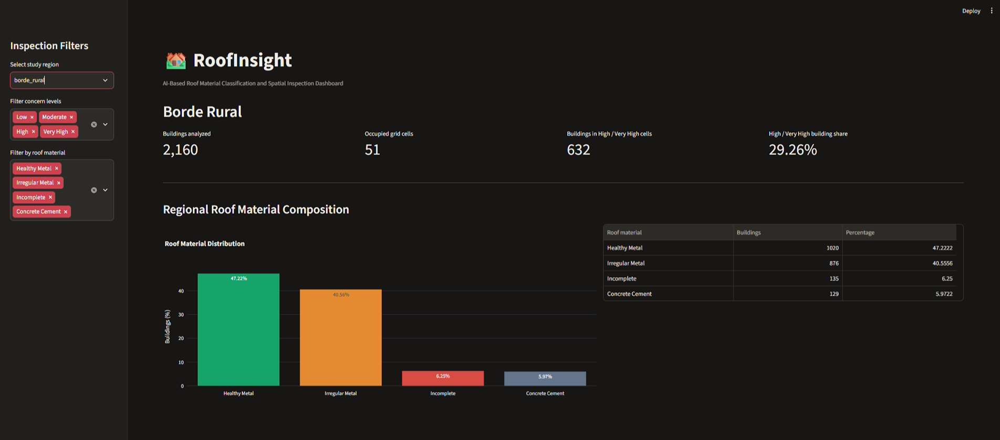
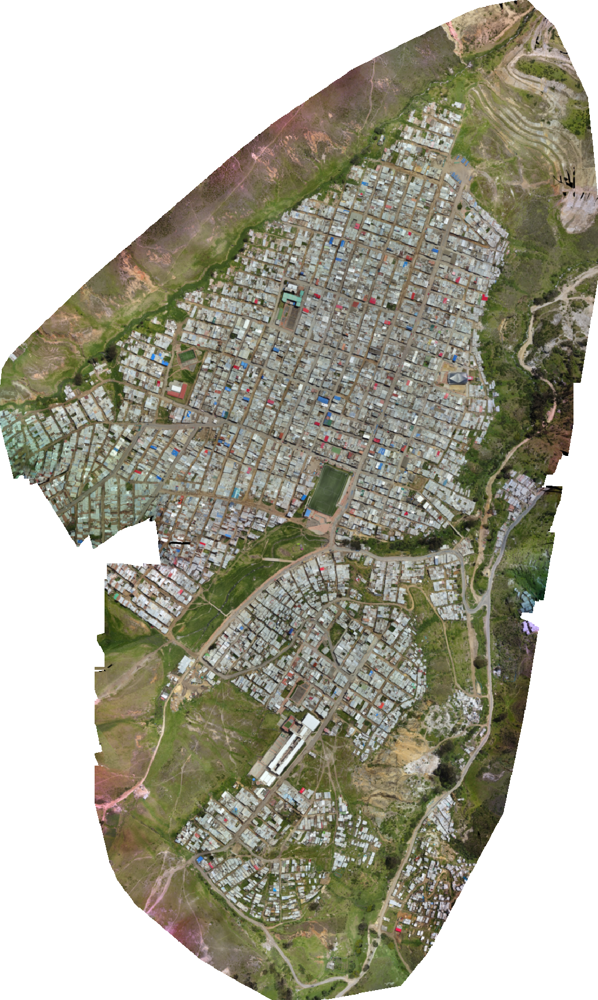
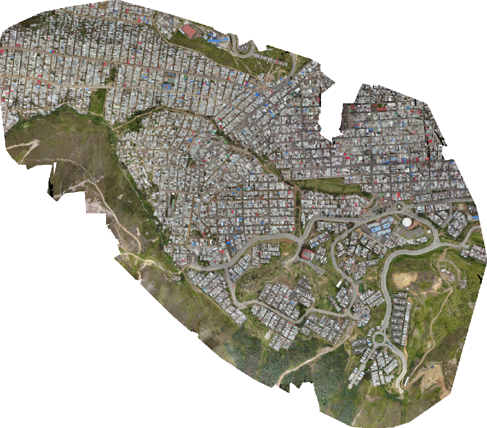
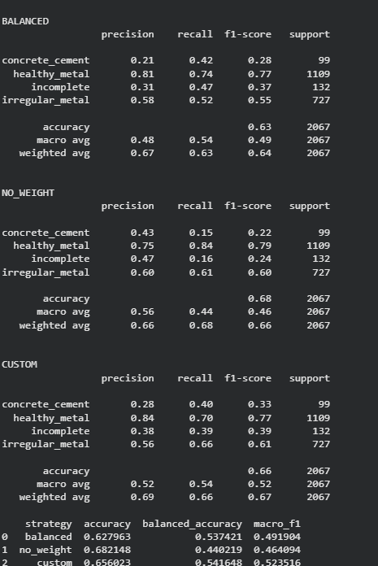
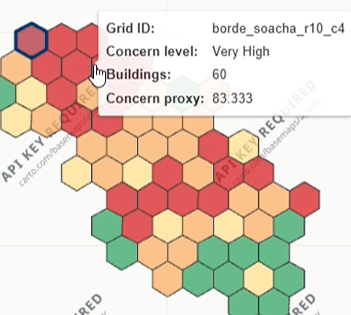
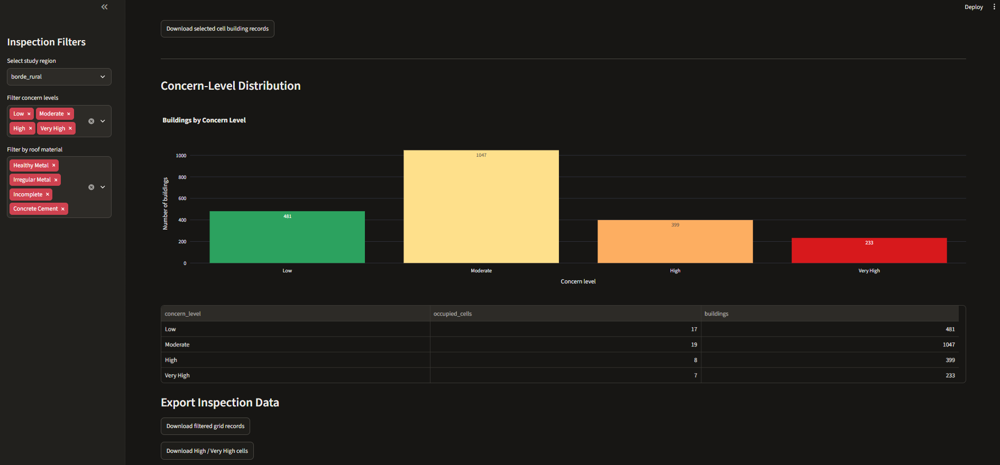

# 🏠 RoofInsight: Roof Material Classification for Disaster Risk Assessment

**SVM-based roof material classification from aerial imagery, with a Streamlit dashboard that maps neighbourhood-level inspection priority in Borde Rural and Borde Soacha, Colombia.**

> Inspired by the [Open AI Caribbean Challenge](https://www.drivendata.org/competitions/58/disaster-response-roof-type/) (DrivenData). **Not an official competition submission.**



---

## 🌍 Overview

RoofInsight combines **Computer Vision, Machine Learning, and Geospatial Analysis** to classify roof materials and visualize areas that may warrant further inspection.

### The workflow

**Aerial Imagery → Feature Extraction → SVM Classification → Spatial Analysis → Concern Mapping → Interactive Dashboard**

1. Extract **44 colour and texture features** using RGB, HSV, LBP and GLCM.
2. Classify roofs into four classes using an **RBF-kernel SVM**:
   - Healthy Metal
   - Irregular Metal
   - Incomplete
   - Concrete Cement
3. Aggregate predictions into **hexagonal grid cells**.
4. Compute a **roof concern proxy** from the share of Irregular Metal and Incomplete roofs.
5. Visualize results through an interactive **Streamlit dashboard**.

### Dataset used

- **10,333 labelled building samples**
- Healthy Metal: **4,957**
- Irregular Metal: **3,116**
- Concrete Cement: **1,684**
- Incomplete: **576**
- 80:20 stratified train-validation split
- `random_state = 42`
- 3-fold stratified cross-validation
- Model selection based on **Macro-F1**

---

## 🗺️ Study Areas

The implementation focuses on two regions in Colombia:

| Borde Rural | Borde Soacha |
|---|---|
|  |  |

---

## 🧠 Methodology

### 1. Image & Data Preparation

Aerial imagery and building-level annotations were processed to prepare labelled roof samples for classification.

The workflow includes:

- Regional data extraction
- Data investigation
- Image patch extraction
- Label preparation
- Stratified train-validation splitting

### 2. Feature Extraction

Each roof image patch is represented using **44 handcrafted colour and texture features**.

| Feature Group | Purpose |
|---|---|
| **RGB** | Colour-channel statistics |
| **HSV** | Hue, saturation and brightness characteristics |
| **LBP** | Local texture patterns |
| **GLCM** | Spatial texture relationships |

### 3. SVM Classification

An **RBF-kernel Support Vector Machine** was used for four-class roof material classification.

The modelling process included:

**Baseline → Hyperparameter Tuning → Class-Weight Experiments → Evaluation → Final Model Selection**

### 4. Spatial Analysis

Building-level predictions are connected to their geographical locations and aggregated into hexagonal grid cells.

The grid-level analysis uses the proportion of:

- **Irregular Metal**
- **Incomplete**

roofs to generate a preliminary roof-based concern indicator.

---

## 📊 Model Results

Four SVM configurations were evaluated on the validation set.

| Model | Accuracy | Balanced Acc. | Macro-F1 |
|---|---:|---:|---:|
| Baseline SVM | 0.5960 | 0.5573 | 0.4716 |
| Balanced SVM | 0.6280 | 0.5374 | 0.4919 |
| No-Weight SVM | **0.6821** | 0.4402 | 0.4641 |
| **Custom-Weighted SVM (Final)** | 0.6560 | **0.5416** | **0.5235** |



### 🏆 Final Model

The **Custom-Weighted SVM** was selected as the final model because it achieved the highest **Macro-F1 score of 0.5235**.

The No-Weight SVM achieved the highest overall accuracy (**68.21%**), but its lower Macro-F1 indicates weaker performance when considering all four classes equally.

The final model therefore prioritizes **balanced class-level performance rather than accuracy alone**.

The trained model is stored in:

```text
models/svm_custom_4class_final.joblib
```

---

## 🗺️ Concern Mapping

RoofInsight converts building-level predictions into a spatial inspection-priority view.

### Concern levels

| Level | Meaning |
|---|---|
| 🟢 **Low** | Lower roof-based concern |
| 🟡 **Moderate** | Moderate roof-based concern |
| 🟠 **High** | Higher roof-based concern |
| 🔴 **Very High** | Highest roof-based concern |

The concern proxy is derived from the share of **Irregular Metal** and **Incomplete** roof predictions within each grid cell.



> ⚠️ **Important:** The concern level is a **preliminary roof-based inspection-priority proxy**. It is not a confirmed structural assessment, storm-risk prediction, or building-safety classification. Field validation and additional building-level information would be required for such conclusions.

---

## 💻 Interactive Dashboard

The Streamlit dashboard brings the model predictions and spatial analysis together in one interface.

### Dashboard capabilities

- 📊 Regional statistics
- 🏠 Roof material distribution
- 🗺️ Interactive concern map
- 🔎 Building-level inspection
- 📥 CSV export
- 📍 Spatial exploration of predicted roof categories

### Dashboard Overview


### Building-Level Inspection




---

## 📁 Repository Structure

```text
ROOF INSIGHT/
│
├── README.md
├── .gitignore
├── app.py
│
├── models/
│   └── svm_custom_4class_final.joblib
│
├── notebooks/
│   ├── 1Extraction_of_borde_rural_files.ipynb
│   ├── 2Investigating_borde_rural_files.ipynb
│   ├── 3Extraction_of_borde_soacha_files.ipynb
│   ├── 4Investigating_borde_soacha_files.ipynb
│   ├── 5Extracting_patches_train_data_both_areas.ipynb
│   ├── 6Feature extraction.ipynb
│   ├── 7svm_4_class_baseline.ipynb
│   ├── 8svm_5_class_baseline.ipynb
│   ├── 9Extracting_patches_test_data_both_areas.ipynb
│   ├── 10Validation on labled images.ipynb
│   └── 11map1.ipynb
│
├── results/
│   ├── evaluations/
│   │   ├── model_comparison.png
│   │   └── model_evaluation.png
│   │
│   └── screenshots/
│       ├── borde_rural_ortho-cog-thumbnail.png
│       ├── borde_soacha_ortho-cog-thumbnail.png
│       ├── building_inspection.png
│       ├── concern_map.png
│       └── dashboard_overview.png
│
└── vulnerability_mapping/
    ├── concern_levels/
    │   └── roof_concern_levels.geojson
    │
    └── spatial_join/
        └── test_buildings_with_predictions.geojson
```

---

## 🚀 Run the Dashboard

### 1. Clone the repository

```bash
git clone https://github.com/ananyasharma131006/roof-material-classification-svm.git
cd roof-material-classification-svm
```

### 2. Install dependencies

```bash
pip install numpy pandas scikit-learn joblib opencv-python scikit-image geopandas shapely streamlit folium streamlit-folium plotly
```

### 3. Launch the dashboard

```bash
streamlit run app.py
```

The dashboard will open at the local Streamlit URL displayed in the terminal.

> **Note:** The application expects the trained model and associated project data files at the paths configured in `app.py`.

---

## 📓 Notebooks

The notebooks document the development workflow and can be run sequentially in **Google Colab** after updating the relevant Google Drive paths.

| Notebook | Purpose |
|---|---|
| 1 | Borde Rural data extraction |
| 2 | Borde Rural data investigation |
| 3 | Borde Soacha data extraction |
| 4 | Borde Soacha data investigation |
| 5 | Training patch extraction |
| 6 | Feature extraction |
| 7 | Four-class SVM baseline |
| 8 | Five-class SVM baseline |
| 9 | Test patch extraction |
| 10 | Validation on labelled images |
| 11 | Spatial concern mapping |

---

## 📦 Data

The original aerial imagery and annotations are **not included in this repository**.

The source GeoTIFF files are several gigabytes in size, and redistribution of competition data is restricted under the relevant DrivenData competition rules.

Download the required Borde Rural and Borde Soacha data through the official competition page:

[**Open AI Caribbean – Disaster Risk from Aerial Imagery**](https://www.drivendata.org/competitions/58/disaster-response-roof-type/)

Dataset attribution:

- **World Bank Global Program for Resilient Housing**
- **WeRobotics**
- Hosted by **DrivenData**

---

## ⚠️ Limitations

- The model is evaluated on only **two study regions**, so generalization to other geographical areas is not guaranteed.
- Lighting, shadows, image quality and visually similar roof materials can cause classification errors.
- Minority classes, particularly **Incomplete**, are more difficult to classify reliably.
- The concern proxy is based only on roof-material predictions and does not incorporate structural, meteorological or field-survey information.
- The concern levels have **not been validated against field-survey data**.

### Safety interpretation

The system should be treated as an **inspection-support tool**, not as a replacement for professional structural assessment.

Final safety, engineering or disaster-response decisions require appropriate professional inspection and additional evidence.

---

## 🔮 Future Scope

Potential extensions include:

- 🌎 Testing on additional geographical regions.
- 🧠 Exploring alternative machine-learning and deep-learning approaches.
- 🏗️ Incorporating additional building and geographical attributes.
- 🛰️ Using larger and more diverse aerial imagery datasets.
- 📍 Validating concern indicators through field surveys.
- 📈 Improving classification performance, particularly for minority classes.
- 💻 Expanding dashboard analytics and spatial interaction.

---

## 👥 Authors

**Ishita & Ananya Sharma**


---

## 🛠️ Technology Stack

| Area | Technologies |
|---|---|
| Programming | Python |
| Machine Learning | Scikit-learn, SVM |
| Computer Vision | RGB, HSV, LBP, GLCM |
| Data Processing | NumPy, Pandas |
| Geospatial Analysis | GeoPandas, Shapely, GeoJSON |
| Mapping | Folium |
| Dashboard | Streamlit |
| Visualization | Plotly |
| Development | Google Colab, Jupyter Notebook, VS Code |
| Version Control | Git, GitHub |

---

## 🔗 Repository

**GitHub:**  
[RoofInsight – Roof Material Classification SVM](https://github.com/ananyasharma131006/roof-material-classification-svm)

---

### 🏠 RoofInsight

*From Aerial Imagery to Intelligent Roof Inspection.*

**Built with Python • Machine Learning • Computer Vision • Geospatial Analysis**

⭐ **Thank you for exploring the project!**
